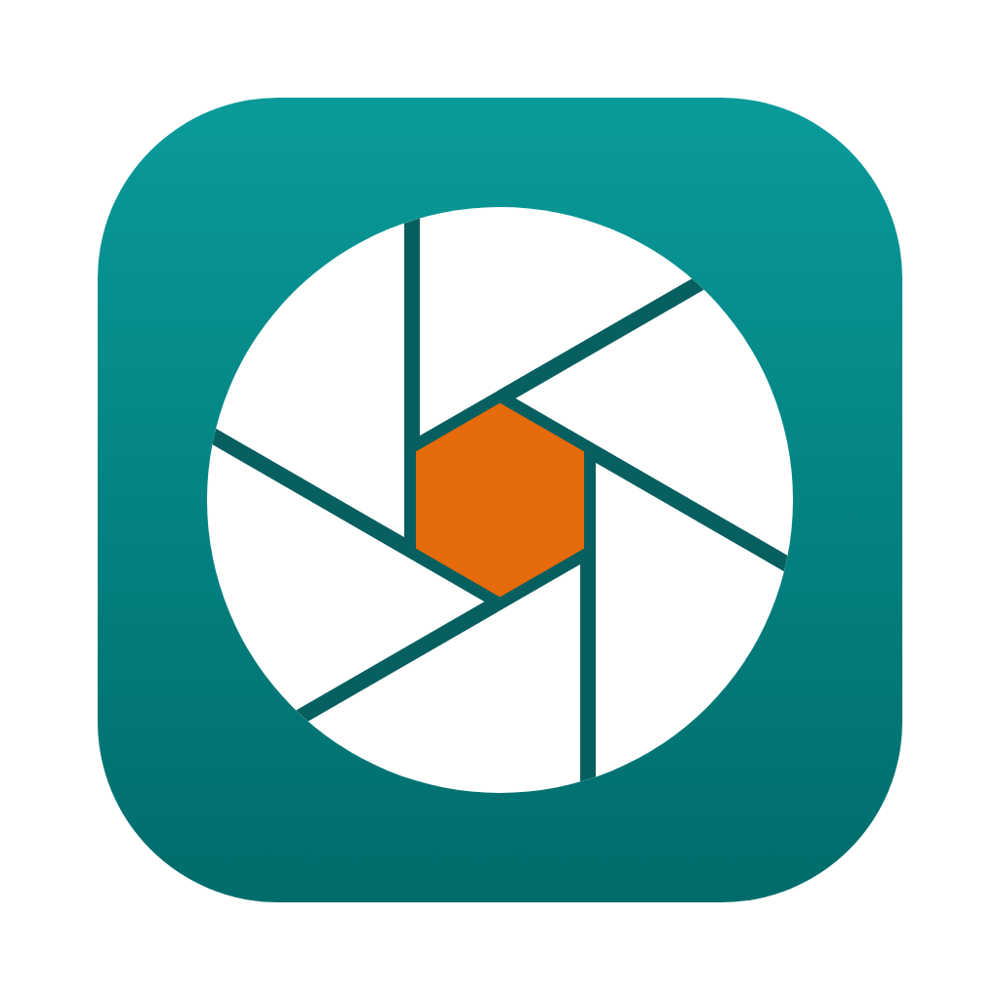
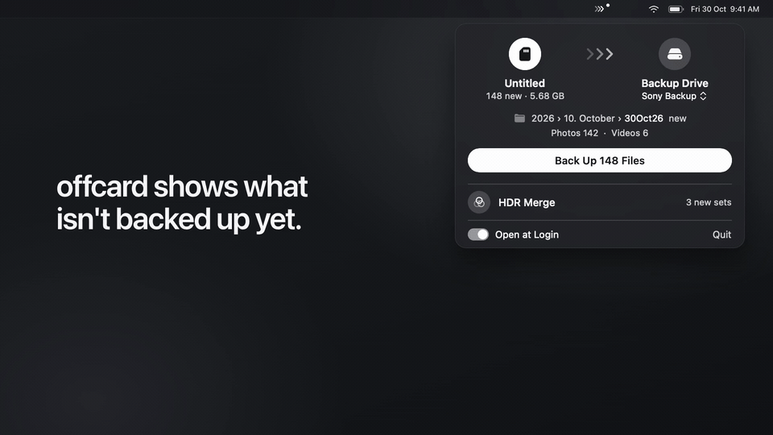

<div align="center">



# offcard

**Utility tools for Sony cameras: card backup, HDR merge**

[](https://github.com/imsoumya18/offcard/releases/latest)
[](https://github.com/imsoumya18/offcard/actions/workflows/build.yml)
[](https://github.com/imsoumya18/offcard/releases)
[](#install)
[](LICENSE)

[Install](#install) • [How to use](#how-to-use) • [Tech stack](#tech-stack) • [What's new](CHANGELOG.md)



</div>

## Install

**Mac and Linux:** open Terminal and run

```bash
curl -fsSL https://raw.githubusercontent.com/imsoumya18/offcard/main/install.sh | bash
```

**Windows:** open PowerShell and run

```powershell
irm https://raw.githubusercontent.com/imsoumya18/offcard/main/install.ps1 | iex
```

offcard then appears in Applications, the Start menu, or your app menu. Run the same line again
to update; the app tells you when a new version is out.

<details>
<summary>Download the app directly instead</summary>

| Your computer | Download |
|---|---|
| Windows | [offcard-windows.exe](https://github.com/imsoumya18/offcard/releases/latest/download/offcard-windows.exe) |
| Mac, Apple chip | [offcard-macos-apple-silicon.zip](https://github.com/imsoumya18/offcard/releases/latest/download/offcard-macos-apple-silicon.zip) |
| Mac, Intel chip | [offcard-macos-intel.zip](https://github.com/imsoumya18/offcard/releases/latest/download/offcard-macos-intel.zip) |
| Linux, 64-bit | [offcard-linux.zip](https://github.com/imsoumya18/offcard/releases/latest/download/offcard-linux.zip) |

Apps downloaded in a browser get a security warning the first time. On a Mac, allow it in
**System Settings → Privacy & Security → Open Anyway**; on Windows, click **More info → Run
anyway**. The one-line install avoids this.
</details>

## How to use

**On a Mac**, offcard lives in the menu bar. Click its ››› icon for a small panel: your memory
card on the left, the drive it backs up to on the right, and HDR Merge below. When you put in a
card with new photos, the icon gets a dot. It opens at login; switch that off at the bottom of the
panel.

**On Windows and Linux**, open offcard and pick a tool.

### Card Backup

1. Put the memory card in, and connect the drive you back up to.
2. Choose where the backup goes, once: on a Mac, **Choose Folder…** in the panel (afterwards, click
   the folder's name under the drive to pick another one or a recent one); on Windows and Linux,
   **Card Backup**, then **Choose backup folder**.
3. Click **Back Up**. The button says how much is new, for example **Back Up 148 Files**, and on a
   Mac the panel shows the day folder it goes into first. Only new photos and videos are copied;
   on a Mac, the card's icon becomes a ring that fills as it copies.
4. Before formatting the card, click **Check Before Formatting** (**Check it's safe to format** on
   Windows and Linux). When it says *Safe to format*, click **Eject**.

The card is only ever read, never changed. Your backup folder is sorted by the day you took each
shot, and every file gets one clean number in shooting order:

```
Camera Backup/                      ← the folder you chose
└── 2026/
    └── 10. October/
        └── 24Oct26/
            ├── Photos/
            │   ├── DSC00001.ARW
            │   └── DSC00001.JPG      ← shot as RAW + JPG
            ├── Videos/
            │   ├── C00001.MP4
            │   └── C00001M01.XML
            └── HDR/                  ← made by HDR Merge
                └── DSC00012-00014_HDR.jpg
```

### HDR Merge

1. On the camera, shoot with **Continuous Bracket (BRK C)** in **RAW**, for example 3 shots at
   ±2 EV.
2. Click **HDR Merge**. On a Mac, the panel slides to its HDR page and looks in your backup folder;
   click the folder's name under the title to use another one. Every folder inside it is searched.
   On Windows and Linux, choose a folder.
3. The new bracketed sets are ticked for you. Click **Merge 3 Sets** (on Windows and Linux,
   **Merge to HDR**). Each takes about 30 seconds.

Results go into the day's `HDR` folder, beside `Photos` and `Videos` (in other folders, an `HDR`
folder next to the shots). The original shots are never changed.

## Tech stack

| Part | Built with |
|---|---|
| Mac app | Native [SwiftUI](https://developer.apple.com/xcode/swiftui/) menu bar app, built like the Mac's own menus, with the Python engine inside |
| Windows and Linux | One HTML page: in a [pywebview](https://pywebview.flowrl.com/) (WebView2) window on Windows, in the browser on Linux |
| Backup engine | Python standard library: EXIF reading, content fingerprints, byte-by-byte verify |
| HDR merge | [NumPy](https://numpy.org/), [rawpy](https://github.com/letmaik/rawpy) ([LibRaw](https://www.libraw.org/)), [Pillow](https://python-pillow.org/): noise-weighted RAW merge, alignment, ghost removal, exposure fusion |
| Packaging | [PyInstaller](https://pyinstaller.org/), with one-line installers in Bash and PowerShell |
| CI and releases | GitHub Actions: tests and builds for Windows, macOS (Apple and Intel) and Linux |

How it all works, running from source and releasing: [DEVELOPMENT.md](DEVELOPMENT.md).

## Good to know

- Made for Sony Alpha and ZV cameras; tested on the a6600. Folder dates come from the camera's clock.
- Your photos never leave your computer. The only internet use is checking for a new version.
- offcard was called *ShotLoft* up to v0.9.1, and *Sony Import* up to v0.4.0.
- **Uninstall:** delete offcard from Applications (Mac), `%LOCALAPPDATA%\Programs\offcard` and
  its Start menu shortcut (Windows), or `~/.local/bin/offcard` and
  `~/.local/share/applications/offcard.desktop` (Linux). Settings are in `~/.offcard.json`.

## License

[MIT](LICENSE) © imsoumya18
