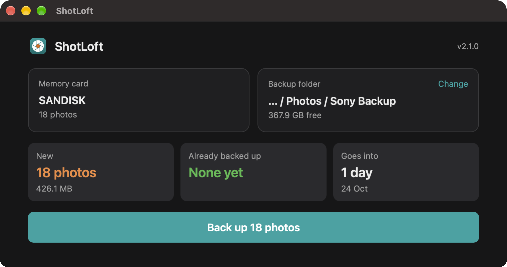

# ShotLoft

[](https://github.com/imsoumya18/shotloft/releases/latest)
[](https://github.com/imsoumya18/shotloft/actions/workflows/build.yml)
[](https://github.com/imsoumya18/shotloft/releases)
[](#install)
[](#install)
[](LICENSE)

A simple app that backs up the photos and videos from your Sony camera's memory card, neatly
sorted into **Year → Month → Day** folders. Open it any time: it only copies what's new. Shot an
exposure bracket? It merges it into one natural-looking **HDR** photo.

<sub>ShotLoft was called *Sony Import* up to v2.0.0. Already using it? Run the install line below once to switch.</sub>

<p align="center"></p>

## Install

### Mac and Linux: one line, no security warnings

1. Open **Terminal**: press <kbd>⌘</kbd> <kbd>Space</kbd>, type `Terminal`, press <kbd>Enter</kbd>.
2. Paste this line and press <kbd>Enter</kbd>:

   ```bash
   curl -fsSL https://raw.githubusercontent.com/imsoumya18/shotloft/main/install.sh | bash
   ```

3. **ShotLoft** now appears in your Applications folder and Launchpad. Open it whenever you
   want to back up a card.

It picks the right version for your computer (Mac with Apple or Intel chip, or Linux) by itself.
To update, run the same line again; the app tells you when there's a new version. On Linux,
ShotLoft appears in your app menu and opens in your web browser.

### Windows: one line, no security warnings

1. Open **PowerShell**: click Start, type `PowerShell`, press <kbd>Enter</kbd>.
2. Paste this line and press <kbd>Enter</kbd>:

   ```powershell
   irm https://raw.githubusercontent.com/imsoumya18/shotloft/main/install.ps1 | iex
   ```

3. **ShotLoft** is now in your Start menu. Search for it whenever you want to back up a card.

To update, run the same line again. No admin rights needed.

<details>
<summary>Prefer to download the app directly?</summary>

| Your computer | Download |
|---|---|
| Windows | [shotloft-windows.exe](https://github.com/imsoumya18/shotloft/releases/latest/download/shotloft-windows.exe) |
| Mac with Apple chip (M1, M2, M3…) | [shotloft-macos-apple-silicon.zip](https://github.com/imsoumya18/shotloft/releases/latest/download/shotloft-macos-apple-silicon.zip) |
| Mac with Intel chip | [shotloft-macos-intel.zip](https://github.com/imsoumya18/shotloft/releases/latest/download/shotloft-macos-intel.zip) |
| Linux (64-bit) | [shotloft-linux.zip](https://github.com/imsoumya18/shotloft/releases/latest/download/shotloft-linux.zip) |

- **Mac:** unzip it, drag **ShotLoft** into Applications, and open it. Because it was
  downloaded in a browser, macOS blocks it the first time:
  1. Click **Done**.
  2. Go to **System Settings → Privacy & Security**.
  3. Scroll down and click **Open Anyway**.

  The Terminal line above avoids this, which is why it's the recommended way.
- **Windows:** double-click it. On "Windows protected your PC", click **More info** → **Run anyway**.
  The PowerShell line above avoids this.
- **Linux:** unzip it and run `shotloft`. It opens in your web browser.
</details>

## How to use it

1. Put the memory card in your computer, and plug in the drive you back up to.
2. Open **ShotLoft**. It finds the card by itself.
3. The first time, click **Choose backup folder** and pick any folder on any drive. It remembers
   the folder for next time.
4. It shows what's new and what's already backed up. Click **Back up** and watch the progress bar.
5. **Planning to format the card?** Click **Check it's safe to format**. It checks every file
   byte by byte and tells you when it's safe to format the card in your camera.
6. Click **Eject card** and take it out.

Your backup folder will look like this:

```
Camera Backup/                ← the folder you chose
└── 2026/
    └── 9. September/
        └── 05Sep26/
            ├── DSC00001.ARW
            ├── DSC00001.JPG
            ├── Videos/
            │   ├── C00001.MP4
            │   └── C00001M01.XML
            └── HDR/                       ← only if you merge bracketed shots
                └── DSC00012-00014_HDR.jpg
```

### HDR: merge bracketed shots

For a scene with very bright and very dark parts (a room with a window, a sunset), take a few
shots at different exposures and let ShotLoft merge them into one photo where both look right.

1. **On the camera:** set the drive mode to **Continuous Bracket** (BRK C), for example 3 shots at
   2.0 or 3.0 EV, and shoot **RAW**. Hold the camera steady, or use a tripod.
2. **In ShotLoft:** the **HDR** section under your backup lists every day that has photos. Pick a
   day, and it finds the bracketed sets by itself, with a preview of each.
3. Tick the sets you want and click **Merge to HDR**. Each takes about 30 seconds.
4. The result goes into an `HDR` folder inside that day, named after the shots it came from. Your
   original photos are never changed. Tick **Also save a 16-bit TIFF** if you want to edit the
   result further in Lightroom or Photoshop.

## What it does

**Keeps your photos safe**
- Never changes your memory card. It only reads from it.
- Checks there's enough space on your backup drive before copying anything.
- Tells you when it's safe to format the card, after checking every file byte by byte.
- Safe to interrupt. If you close the window midway, just open it again to finish.
- Ejects the card for you, so you can take it straight out.

**Keeps them organised**
- Sorts everything by the date you took it, with videos in a `Videos` folder inside their day.
- Never copies the same photo twice, even if you renamed files in the backup or use several cards.
- Fills gaps: if a video or RAW + JPG photo is only half backed up, it copies just the missing half.
- Gives every file one clean number in shooting order (`DSC00001`…, `C00001`…), so names never clash.
- Shot in RAW + JPG? It offers to move the extra JPGs to the Trash, where you can restore them.

**Makes HDR photos**
- Finds your bracketed shots by itself, and merges each set into one natural-looking photo:
  detail in the bright window *and* the dark corner, with no "HDR look".
- Lines up handheld shots, and leaves out anything that moved between them, so there are no ghosts.
- Uses every shot's clean parts, so shadows have far less noise than any single shot.
- Saves a full-size JPG, and a 16-bit TIFF for editing if you want one.

**Stays easy**
- One window: your card, your backup folder, what's new, and one button.
- One line to install on Windows, Mac or Linux, with no security warnings.
- Follows your computer's light or dark mode, and tells you when an update is out.

## Good to know

- **Cameras:** works with Sony Alpha (a6000 series, a7 series…) and ZV cameras. Tested on the a6600.
- **Folder dates use the camera's clock**, so make sure it's set correctly.
- **Checking a full card takes about a minute** before copying starts. The byte-by-byte
  "safe to format" check takes about a minute for every 2 GB on the card, depending on your card
  reader.
- **HDR merge** works with RAW (`.ARW`) brackets. It needs about 2.5 GB of free memory while it
  merges. Highlights brighter than even your darkest shot could hold (like the sun) stay white.
- **Privacy:** your photos never leave your computer. The app's window talks only to the app
  itself, on your computer. The only internet use is a quick check with GitHub for a newer version.
- **Windows 10:** the app's window needs Microsoft's free WebView2 component. It's built into
  Windows 11 and most up-to-date Windows 10 PCs.

<details>
<summary>Uninstall</summary>

- **Mac:** drag **ShotLoft** from Applications to the Trash.
- **Windows:** delete the folder `%LOCALAPPDATA%\Programs\ShotLoft`, and the **ShotLoft**
  shortcut in the Start menu (right-click it → Open file location).
- **Linux:** delete `~/.local/bin/shotloft` and `~/.local/share/applications/shotloft.desktop`.

Your backup folder and photos are never touched. The app also keeps one small settings file, the
last backup folder you used, in `.shotloft.json` in your home folder. You can delete that too.
</details>

---

**[What's new](CHANGELOG.md)** in each version. Developers: see **[DEVELOPMENT.md](DEVELOPMENT.md)** for running from source, how it works, and
releasing. Licensed under [MIT](LICENSE).
